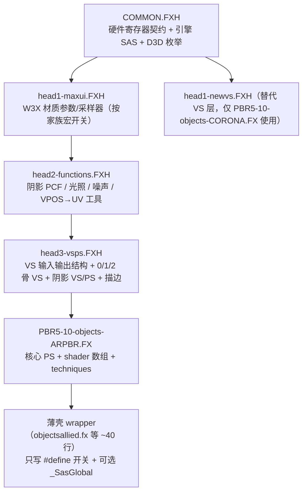

# FXFXH 分层头文件架构（蒸馏版）与可复用原型

> **来源**：用户自研重构库 `C:\Desktop01\MYGITHUB\custom-shaders-RedAlert3\FXFXH`（下文简写 `FXFXH/`；只读参考，严禁修改）。旧版说明见 `readonly/recovered-skills/ra3-hlsl-and-project-context/references/fxfxh-architecture.md`，本文为更新与勘误版。
> `main/COMMON.FXH` 与 `FXFXH/COMMON.FXH` **逐行完全相同**（732 行，`Compare-Object` 无差异）✅已实机验证。

## 1. 层级与 include 链

| 层 | 文件 | 职责 | 对本项目的复用价值 |
|---|---|---|---|
| 0 | `COMMON.FXH` | `_3DSMAX_` 双编译开关；默认 `_SasGlobal`（可 `#define SPECIAL_SAS_HEADER` 自写）；`c0..c255` 固定寄存器；`NumJointsPerVertex/HasShadow/HasRecolorColors/AlphaTestEnable/CullingEnable/DepthWriteEnable/Time`；迷雾/云/阴影采样器（`IGNORE_FOG_CLOUD_SHADOW` 可关）；`#ifdef DEFERRED_RENDER` 下 `WW3D.DepthTexture`、`WW3D.FrameBufferSize`、`View/ViewI/Projection/ProjectionI`；`getEYEpos/getVPmatrix/getSUNdir/getAccentLight/getWarfogUV/getCloudUV/QuaternionRotate/TrilinearShadowPCF`；`D3DBLEND_*/D3DCULL_*/D3DCMP_*/D3DCOLORWRITEENABLE_*` | **项目唯一硬件接口契约**（已在 `main/`） |
| 1 | `head1-maxui.FXH` | 按 `IS_BASIC_W3D_SHADER`（`Texture_0`）/ `IS_OBJECT_BUILDING_SHADER`（`DiffuseTexture/SpecMap/NormalMap`）/ `IS_BUILDNG`（`DamagedTexture`）/ `ALLOW_CUBE_MAP_SAMPLER`（`ENV_CUSTOM`→`Lanyi.EnvironmentTexture`，`ENV_WATER`→`Water.LightSpaceEnvironmentMap`，默认 `Objects.LightSpaceEnvironmentMap`）/ `USE_IRRADIANCE_BOX`（`Lanyi.PbrIrradianceTexture`）声明材质贴图 `[src: FXFXH/head1-maxui.FXH#L23-L210]` | G-Buffer PS 直接复用同名采样器，保证 W3X 材质参数名不变 |
| 2 | `head2-functions.FXH` + `usefulmath.hlsl` | `getShadowMapUV`、`hp_invshadow_*`（双线性/三线性/抖动/交叉阴影）、`dx9vpos_2NDCXY_2ScreenTexUV`、`hp_specdist*`、`hp_fresnel`、`hp_normalmapper`、`hp_nano_build*`、`dither4x2clip/dither8clip`、`ComputeTangentSpaceFacet` | 光照合成 pass 的阴影/高光函数可直接搬用 |
| 3 | `head3-vsps.FXH` | `VS_H_output`（`COLOR0`、`TEXCOORD0..7`，法线/切线带 `_centroid`）；`VS_H_00skin/11skin/22skin`、`VS_L_*`（无切线）、`VS_ShadowMaker_00/11/22skin`、`PS_ShadowMaker_NoAlphaTest`、`VS_outline_*` | **G-Buffer VS 的直接来源**：世界空间 P/N/T/B 已算好，只需追加视空间深度 |
| 4 | `PBR5-10-objects-ARPBR.FX` | `PS_H_ARPBR`（前向 PBR）、`PS_LOW_ARPBR`、`PS_ShadowMaker_ARPBR`；`VSchooserExpr()`、`SMPSchooserExpr()`；`technique Default / Default_M / _CreateShadowMap`（`_3DSMAX_` 时 `MAXPREV`） | G-Buffer technique 的插入点（见 §3） |
| 5 | wrapper `objects*.fx` / `buildings*.fx` | 只设功能宏并 include 第 4 层 | 新增 G-Buffer 后 wrapper 无需改动即可全部获得新 technique |

## 2. 关键约定（📄源码确认，均来自 FXFXH）

1. **蒙皮 VS 选择**：`VSchooserExpr()` = `clamp(NumJointsPerVertex, 0, 1)`；定义 `COMPILE_SOFTSKIN_VS` 时允许 2（`InfantrySkin` 材质参数）`[src: FXFXH/PBR5-10-objects-ARPBR.FX#L625-L672]`。technique 中写 `VertexShader = VS_H_Array[ VSchooserExpr() ];`（D3DX preshader 在 CPU 端求值）。
2. **骨骼取数**：`int BoneIndex = floor(i.blendindices.x * 2); Quaternion2Matrix(WorldBones[BoneIndex]); WorldBones[BoneIndex+1]`（`.xyz` 平移，`.w` 骨骼透明度乘进 `VertexColor.w`）`[src: FXFXH/head3-vsps.FXH#L153-L158]`；2 骨软绑定读 `POSITION0/1`、`NORMAL0/1`…与 `BLENDWEIGHT` `[src: FXFXH/head3-vsps.FXH#L184-L214]`。
3. **刚体**：`o.WorldP = mul(float4(pos,1), World)`；法线 `mul(n, (float3x3)World)` `[src: FXFXH/head3-vsps.FXH#L110-L113]`。
4. **阴影 PS 选择**：`SMPSchooserExpr()` 按 `AlphaTestEnable`，`FORBID_SHADOW_ALPHATEST` 强制 0，`FORCE_ENABLE_ALPHA_CLIP_BEFORE_RETURN` 强制 1 `[src: FXFXH/PBR5-10-objects-ARPBR.FX#L674-L689]`。G-Buffer PS 数组照抄此模式。
5. **功能宏**（wrapper 中设置）：`FORBID_FACTION_COLOR`、`DYNAMIC_CLOUD_REF`、`ALLOW_STEALTH`、`RENDER_BACKFACE`（`CullMode=1`）、`FORBID_SHADOW_ALPHATEST`、`OPACITY_OVERRIDE_CLIP/OUTPUT`、`ALLOW_CLIP_TEXTURE_ALPHA`、`ALLOW_CLIP_VERTEX_ALPHA` / `IS_BUILDNG` / `IS_NANO_BUILDUP`（三者互斥）、`KEEP_ALPHA_TEXTURE_SAMPLER_SAME`、`DAMAGE_BURNRED`、`SHADOW_DITHER`、`REPLACE_DEFAULT_TECHNIQUE`、`COMPILE_SOFTSKIN_VS`、`USE_SPECIAL_PBR_W3X_CONSTANT`、`DEDICATED_METAL_CHANNEL`、`NRM_BLUE_AO` 等 `[src: FXFXH/PBR5-10-objects-ARPBR.FX#L11-L38]`。
6. **剔除约定**：RA3 中 `CullMode = 2`（`D3DCULL_CW`）是"正常剔除背面"；`3`（`CCW`）= 只画背面（体积光、挖洞内壁用）；`1` = 双面 `[src: main/COMMON.FXH#L711-L713；FXFXH/FXcutDepthBuffer.FX#L146]`。
7. **RenderBin 自定义**：wrapper 用 `SPECIAL_SAS_HEADER` 自写 `_SasGlobal` 并加 `string RenderBin = "…"`。FXFXH 现状：`objectsgeneric/objectsgenericlightmap/objectsroads/objectsterrain` → `TerrainLikeGroundObject`；`ObjectsFormationPreview/basicw3dMASK/basicw3dSWAP` → `StaticSort1`；`BasicW3dHolographic` → `StaticSort3`；`FXdeferredpointlight/FXscreenSpaceShadow` → `StaticSort5`；`FXcutDepthBuffer` → `Bridge` 📄。注意：`objectsgeneric` 改 bin 是用户的设计选择，与官方（无注解）不同。
8. **`TERRAIN.FX` 例外**：不 include `COMMON.FXH`（`//#include "COMMON.FXH"  //hope it works`@L17），自行用 `register(vs, cN) : register(ps, cN)` 声明 `c0..c5`、`c89`、`c113`、`c117`、`c119`、`c123`，**`World c124` 与 `WorldBones c128` 被注释掉**（地形不用）`[src: FXFXH/TERRAIN.FX#L8-L112]`。保留与官方同名 technique（`TerrainTile/Cliff/Road/Scorch` + `_M`、`_CreateShadowMap`、`_CreateDepthMap`）。改它时须自行保证固定槽位不被材质参数占用。

## 3. 可复用原型（全部已用 `main\fxc.exe /T fx_2_0` 编译通过 ✅fxc实测；实机效果见各条置信）

| 原型 | 技术要点 | 已知问题 / 改进点 | 置信 |
|---|---|---|---|
| `FXdeferredpointlight.FX` | 球体网格 × `Range` + `World[3].xyz` 平移；`CullMode=D3DCULL_CCW`（只画背面）+ `ZFunc=GREATEREQUAL` + `ZWriteEnable=0` + `ONE/ONE` 加色，相机在球内也正确；PS 采样 `WW3D.DepthTexture`，`vpPixel = ViewSpacePos/ViewSpacePos.z * depth`，`mul(float4(vpPixel,0), ViewI)` 得相机相对世界坐标；**法线用 `cross(ddy(wp2eye), ddx(wp2eye))` 从深度重建（面片法线）**；`RenderBin = "StaticSort5"`；`Default_M` 是空 technique（VS 输出 `z=-2` 裁掉） `[src: FXFXH/FXdeferredpointlight.FX#L83-L272]` | 半像素偏移写死 `+0.5/4096.0`（L141），应改为 `+0.5/FrameBufferSize`；G-Buffer 就绪后应改读法线 RT 而非 ddx/ddy 重建 | 📄源码确认；实机可用性 ❓待实测（文件注释 "try if this can read post fx"） |
| `FXscreenSpaceShadow.fx` | 全屏 quad（`Position.xy` 已是 NDC）；`ScreenUV = Position.xy*(0.5,-0.5)+0.5 + 0.5/FrameBufferSize`；`ProjectionI` 求 z=1 视线 → `ViewI` 转世界；`worldPos = EyePosition + WorldEyeRay * viewDepth`；`ShadowMapWorldToShadow` 投影后 4-tap 双线性 PCF + smoothstep；`viewDepth <= 0` 视为天空返回 1 `[src: FXFXH/FXscreenSpaceShadow.fx#L58-L146]` | 可直接作为 Phase 2 方向光阴影项；`HasShadow` 在全屏 quad 上是否被引擎设置 ❓ | 📄源码确认 / ❓待实测 |
| `FXcutDepthBuffer.FX` | 两 pass 模板挖洞：pass0 `ColorWriteEnable=0`、`StencilRef/Mask/WriteMask=128`、`StencilFunc=Always`、`StencilPass=Replace` 标记；pass1 `CullMode=3`、`ZFunc=GreaterEqual`、`StencilFunc=Equal` 绘制内壁；只占用第 8 位以免干扰其他模板位 `[src: FXFXH/FXcutDepthBuffer.FX#L115-L161]` | 部分注释的 Cull 名称写反（L115 写 "CCW" 实为 2=CW） | 📄源码确认 |
| `head3-vsps.FXH` 0/1/2 骨 VS | 见 §2 | 输出结构已占 `COLOR0 + TEXCOORD0..7`，G-Buffer VS 需新结构或复用 `CoordOBJ`/`ShadowCS` 槽位传深度 | 📄源码确认 |
| `PBR5-10-objects-CORONA.FX` | 日冕 PBR 移植到 FXFXH，使用 `head1-newvs.FXH`，读 `Lanyi.EnvironmentTexture`/`Lanyi.PbrIrradianceTexture` | 依赖日冕 SCRAPE 生成 irradiance cube，详见 [corona-pbr-ibl-notes.md](corona-pbr-ibl-notes.md) | 📄源码确认 |

## 4. 在本项目中的落地方式（KISS）
1. `main/` 中新 shader 以 FXFXH 第 1-4 层为模板（需要时把 `head1-maxui/head2/head3` 与核心 `.FX` 复制进 `main/` 再改），**不要**把官方 `Objects.fxh` 宏迷宫搬进来。
2. G-Buffer 编码函数集中到一个共享头（建议名 `main/GBUFFER.FXH`，计划阶段定稿），各家族核心 `.FX` 只新增"VS 数组 + PS 数组 + 一个 technique"。
3. 每个 wrapper 继续只写 `#define`；需要更改 bin 时才用 `SPECIAL_SAS_HEADER`。
