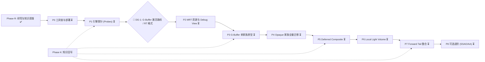

# ROADMAP — RA3-Deferred-Render 阶段路线图与 LLM 溯源档案

> 本文件仅记录**阶段目标、里程碑、设计基线与 LLM 溯源档案**。图形学术语统一采用英文原名。
> 可执行任务卡见 [`plans/README.md`](plans/README.md)，实时任务状态见 [`plans/task-board.md`](plans/task-board.md)。
>
> 状态图例：✅ 完成 · 🟡 进行中 · ⏳ 未开始 · ⛔ 阻塞 · 🔀 决策关口

---

## 1. 阶段流程总览

---

## 2. 已完成阶段：Phase R（研究与知识蒸馏）✅

| 里程碑 | 关键产出 |
|---|---|
| 原版管线逆向与源码对照 | `readonly/llm-analysis/`、`readonly/docs/`（只读归档） |
| 原版管线事实基准 + VRAM 生命周期交互式图表（勘误旧结论：`ShadowMap` 为 `R32F`、`updateDepthMap` 有条件门控、`HUD` 位于 `PostFX` 之后） | [`diagrams/vanilla-pipeline-reference.md`](diagrams/vanilla-pipeline-reference.md)、[`diagrams/design-B-vram-lifeline-matrix.md`](diagrams/design-B-vram-lifeline-matrix.md)、[`diagrams/RA3 Render Pipeline VRAM control.html`](diagrams/RA3%20Render%20Pipeline%20VRAM%20control.html) |
| 知识蒸馏（2 个项目 Skills + 4 本 Dictionaries + 3 篇 Knowledge 文档） | [`.agents/skills/`](.agents/skills/)、[`dictionaries/`](dictionaries/)、[`knowledge/`](knowledge/) |
| 细粒度执行计划（98 张任务卡、Decision Log、Risk Register） | [`plans/README.md`](plans/README.md)、[`plans/task-board.md`](plans/task-board.md)、`plans/phase-*.md` |
| 工作区根目录规范化、外部资源索引与 `.gitignore` 非代码文件过滤 | [`AGENTS.md`](AGENTS.md)、[`README.md`](README.md)、[`tools/README.md`](tools/README.md)、[`.gitignore`](.gitignore) |

---

## 3. 待执行阶段（Phase 0 – Phase 8）

| 阶段 | 核心目标 | 退出标准（Milestone） | 关键依赖 / 风险 |
|---|---|---|---|
| **P0 工具链与部署** | 确定游戏/Mod 部署链路、抓帧工具（PIX/RenderDoc）、`build.ps1`、`Deferred.IsEnabled` A/B 开关 | Canary 部署包与原版画面一致；成功抓取一帧 D3D9 Frame | 需用户配合确认部署路径与抓帧工具 |
| **P1 引擎探针 (Probes)** | 实测 P0 级 Open Questions：`setshaderoverride` 命中率（OQ-01）、缺 `Technique` 回退（OQ-02）、`A2R10G10B10` `RT`（OQ-04）、4-MRT 绑定（OQ-05）、Target 尺寸匹配（OQ-06） | 上述 `OQ` 全部关闭并回写 [`engine-ground-truth.md`](dictionaries/engine-ground-truth.md) | 🔀 决定 `DG-1`（`setshaderoverride` vs `_CreateDepthMap` vs SAS Array）与 `RT` 格式 |
| **P2 MRT 与 Debug View** | 声明 4×32bpp `G-Buffer`、`clear` 验证、编写 `GBUFFER.FXH` 与 `DeferredDebug` 四象限视图 | 抓帧确认 4 `RT` + `D24S8` 正常绑定与采样；`Half-Pixel Offset` 零错位 | 依赖 P1 格式结论 |
| **P3 G-Buffer 原型** | 迁移 `objectsgeneric` 与 `objectsallied`（含 `Skinning`、Alpha `clip()`、HouseColor），验证 `RT3` Linear Depth 等价性 | `Debug View` 下 World Normal、HouseColor、Cutout、`Skinning`、Reconstructed WorldPos 全部正确 | 依赖 `DG-1` 路线结论 |
| **P4 Opaque 家族迁移** | 逐家族迁移 `Objects*`、`Buildings*`、`Infantry`、`BasicW3D`、`Tree*`、`Terrain`；`RT3` 接管 `WW3D.DepthTexture` 并停用 `updateDepthMap` | 场景 Opaque Geometry 覆盖完整；水下与 `Soft Particle` 读取 `RT3` 深度正常 | `Terrain` Overlay（`Cliff`/`Road`/`Scorch`）在 `MRT` 下的 Blend 限制（`DG-T`） |
| **P5 Deferred Composite** | 全屏合成：`DirectionalLight` GGX `PBR` + `Screen-Space Shadow` + `IBL`（`Irradiance Cubemap` + `Prefiltered EnvMap`）+ `Cloud Map` / `Shroud` / `Emissive` + `Forward Residual Pass` | 关闭 Local Light 时，昼/夜场景光照、阴影、金属反射、阵营色、迷雾正确 | `DG-4` `Cubemap` 空间约定；全屏 Quad 下 SAS Light 寄存器可用性（OQ-12） |
| **P6 Local Light Volume** | `Back-Face` + `GREATEREQUAL` + Additive Blend 点光体积，采样 `G-Buffer` 做 `PBR` 着色，提交至 `StaticSort_END`（位于 Composite 后、`updateWaterRefraction` 前） | 同屏上百个 Local Light 无 8 光源断层；`Water Refraction` 可见岸边光照 | OQ-08 `RenderBin` 可用性；OQ-20 `CullMode` 方向确认 |
| **P7 Forward Tail 整合** | 整合 `Water Refraction/Reflection`、`Decal`、Translucent、`Outline`、Particle、`PostFX`（`Distortion` / `Bloom` / `LUT`）HDR 亮度重标定、`HUD`、`WorldBuilder` | 层级顺序与原版完全一致；`Deferred.IsEnabled=false` 时 100% 还原前向基准 | HDR 亮度尺度变化对 `Bloom` / `LUT` 的影响 |
| **P8 可选进阶** | `FXAA`/`SMAA`、`SSAO`、`G-Buffer Decal`、3-MRT 紧凑布局、Stencil Light Volume、模块化 `.scrape` 构建 | 按需选做 | — |
| **Phase K 知识维护** | 每阶段結束将实测结论回写 Dictionaries / Skills / `OQ` | 零“仅存于对话上下文中”的隐性知识 | — |

---

## 4. 设计基线速查（详见 [`plans/README.md`](plans/README.md) §7 Decision Log）

| 维度 | 基线方案 | 状态 |
|---|---|---|
| **G-Buffer 布局 (4×32bpp)** | `RT0` `A8R8G8B8`（`Albedo` sqrt gamma 2.0 + `.a = 128/255` 有效标记）· `RT1` `A2R10G10B10`（World Normal `n*0.5+0.5` + 2-bit Material ID，回退 `A8R8G8B8`）· `RT2` `A8R8G8B8`（`R=Roughness`, `G=Metalness`, `B=AO`, `A=Emissive`）· `RT3` `R32F`（Linear `viewPos.z` = `WW3D.DepthTexture`）· 硬件 `D24S8` `DepthBuffer` | 🔀 待 P1 / DG-1 |
| **激活前提** | `WW3D.IsHdrEnabled == true` 且 `WW3D.IsAntiAliasingEnabled == false` 且 `Deferred.IsEnabled == true`；否则整帧回退 `Forward Shading` | ✅ 已定 |
| **Stencil 分配** | `bit0..1` 原版 `Outline`、`bit2` 原版 `Decal`；Deferred 标记仅用 `bit7`（`0x80`） | 🔀 待 OQ-13 |
| **Light Volume** | `Back-Face` + `ZFunc = GREATEREQUAL` + `ZWriteEnable = false` + `ONE/ONE` Additive + PS 半径 `clip()`，队列 `StaticSort_END` | 🔀 待 OQ-08 / OQ-20 |
| **代码与工具基线** | HLSL 以 `FXFXH` 为基础；SCRAPE 直接编辑 `main/ingame.scrapeo`（带 `# [RA3DR ...]` 锚点标记）；工具与脚本存放在 `tools/` | ✅ 已定 |

---

## 5. 产出物归属与大模型溯源档案（LLM Provenance & Authorship Ledger）

> **目的**：记录各阶段成果的主导大模型。后续小型推理模型执行任务卡时，若遇到文风差异、参数命名倾向或跨阶段衔接问题，可按本表快速定位设计上下文。
> **规则**：每次更新重大进展、完成里程碑或调整架构规划时（不含细微文字修正），必须在本表与 [`plans/task-board.md`](plans/task-board.md) 备注列同步登记负责的模型名称与版本。

### 5.1 模型交付总览表

| 贡献大模型 | 工作时间 | 宏观负责模块 | 细节产出成果文件 | 文风与工程特征 |
|---|---|---|---|---|
| **Claude Opus 5.5 (Medium)** | 2026-11-04 11:20 – 12:59 *(12:59 触发 429 配额耗尽中断)* | 1. 初版根目录总纲与架构设计 2. 全量项目专有 Skills 与知识库蒸馏（4 Subagents） 3. 规划体系总纲与 Phase 0..2 任务卡（Planner Subagent） | - [`AGENTS.md`](AGENTS.md) / [`README.md`](README.md) 初版 - [`.agents/skills/ra3-scrape-pipeline/`](.agents/skills/ra3-scrape-pipeline/SKILL.md)（全量） - [`.agents/skills/ra3-fx-shader/`](.agents/skills/ra3-fx-shader/SKILL.md)（全量） - [`dictionaries/`](dictionaries/)（4 份字典 + 蒸馏笔记） - [`knowledge/`](knowledge/)（`engine-behavior.md`、`open-questions.md`、`deferred-techniques-sm3.md`） - [`plans/README.md`](plans/README.md) - [`plans/phase-0-toolchain-and-deploy.md`](plans/phase-0-toolchain-and-deploy.md) - [`plans/phase-1-engine-probes.md`](plans/phase-1-engine-probes.md) - [`plans/phase-2-mrt-and-debug-view.md`](plans/phase-2-mrt-and-debug-view.md) | **深度防守型工程**：高度重视 IDA 反编译证据链、D3D9 边界行为与源码行号互链；单篇文档推导详尽。 |
| **Gemini 3.8 Flash (High)** | 2026-11-04 13:06 – 13:15 | 1. 429 中断现场恢复与断点接管 2. 补全 Phase 3..8 与 Phase K 全部任务卡 3. 建立 98 张任务卡全局状态看板 4. 建立大模型溯源规范与档案 | - [`plans/phase-3-gbuffer-prototype.md`](plans/phase-3-gbuffer-prototype.md) - [`plans/phase-4-opaque-migration.md`](plans/phase-4-opaque-migration.md) - [`plans/phase-5-deferred-composite.md`](plans/phase-5-deferred-composite.md) - [`plans/phase-6-light-volumes.md`](plans/phase-6-light-volumes.md) - [`plans/phase-7-forward-tail-integration.md`](plans/phase-7-forward-tail-integration.md) - [`plans/phase-8-optional-upgrades.md`](plans/phase-8-optional-upgrades.md) - [`plans/phase-K-knowledge-maintenance.md`](plans/phase-K-knowledge-maintenance.md) - [`plans/task-board.md`](plans/task-board.md) - [`ROADMAP.md`](ROADMAP.md) §5 初版 | **强执行与标准化导向**：步骤高度原子化、扁平直观，聚焦可直接复制执行的命令与 HLSL 代码段。 |
| **Gemini 4 Argon (Medium)** | 2026-11-07 18:21 – 18:26 | 1. 根目录文档（`AGENTS.md` / `README.md` / `ROADMAP.md`）降噪精简与英文图形学术语统一 2. 建立外部资源索引目录（本机源码/DX SDK 备份 + GitHub/MS Learn 链接） 3. 整合 `tools/` 目录说明与 `.gitignore` 全量非代码文件过滤规则 4. 补充 `README.md` 至 `diagrams/` 图表的 GitHub 直达链接 | - [`AGENTS.md`](AGENTS.md)（精简重构 + §3 外部资源索引） - [`README.md`](README.md)（精简重构 + `diagrams/` 链接 + §4 外部资源索引） - [`ROADMAP.md`](ROADMAP.md)（术语消歧 + §5.1 溯源更新） - [`.gitignore`](.gitignore)（屏蔽全部 EXE / 图像 / 二进制 / 缓存） - [`tools/README.md`](tools/README.md)（新增工具目录说明） - [`plans/README.md`](plans/README.md)（同步 `tools/` 路径说明） | **结构化索引与消歧导向**：压缩上下文噪音，统一使用无歧义英文图形学术语，理顺内外部资源路由。 |

---

### 5.2 跨模型交接检查点（Logic Transition Checkpoints）

由于任务卡在 **Phase 2 与 Phase 3 之间** 经历了模型切换（Claude Opus 5.5 → Gemini 3.8 Flash），子 Agent 执行时需重点核对以下 3 个衔接点：

1. **`DG-1`（G-Buffer 激活路线）向 Phase 3/4 的传导**：
   - `P1-T13`（Claude 编写）设立了路线 1（`setshaderoverride`）、路线 2（`_CreateDepthMap`）与路线 3（SAS `Deferred.GBufferMode` 数组）三条支路；`P3-T03` 与 Phase 4（Gemini 编写）均保留了按 `DG-1` 结论分支的指令。执行 `P3-T03` 前必须确认 `DG-1` 已在 [`engine-ground-truth.md`](dictionaries/engine-ground-truth.md) 定稿。
2. **`main/fx/GBUFFER.FXH` 编解码签名一致性**：
   - `P2-T01`（Claude 编写）定义了 `GB_Encode`、`GB_Decode*`、`GB_ScreenUVFromVPos`；Phase 3..6（Gemini 编写）全部调用相同函数名。`P2-T01` 落地后严禁私自更改函数名或参数顺序。
3. **`Stencil` 掩码与 `RT0.a` 有效标记约定**：
   - 全流程统一：`bit0..1` 为 `Outline`、`bit2` 为 `Decal`、`bit7`（`0x80`）为 Deferred 标记；已移植 `G-Buffer PS` 统一写 `RT0.a = 128.0/255.0`（`0.502`）用于识别前向污染像素（D19）。
