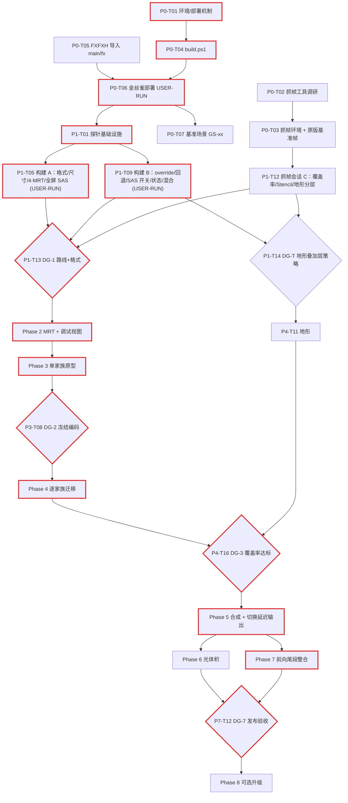

# RA3-Deferred-Render 执行计划总览（plans/）

> **用途**：本目录是"正向 → 延迟着色"改造的**唯一执行计划**。它面向**上下文有限的小型推理模型子代理**：每张任务卡（Task Card）都自带目标、必读文件、逐步操作、验证命令、验收标准、失败处理与知识回写，执行者**只需读本 README 的 §1–§4 + 一张任务卡 + 卡中列出的上下文**即可开工。
> **上位约束**：[`AGENTS.md`](../AGENTS.md) §1（平台红线）、§3.1（HLSL 硬约束）、§4（实机优先 / KISS）始终生效；与本计划冲突时以 AGENTS.md 硬约束为准，并按 §5 升级给 lead。
> **知识来源**：[`ra3-scrape-pipeline`](../.agents/skills/ra3-scrape-pipeline/SKILL.md)、[`ra3-fx-shader`](../.agents/skills/ra3-fx-shader/SKILL.md)、[`knowledge/`](../knowledge/)、[`dictionaries/`](../dictionaries/)、[`diagrams/vanilla-pipeline-reference.md`](../diagrams/vanilla-pipeline-reference.md)。旧路线图 [`readonly/docs/03_DEFERRED_RENDERING_ROADMAP.md`](../readonly/docs/03_DEFERRED_RENDERING_ROADMAP.md) 仅作历史参考，**以本目录为准**。

## 文件索引

| 文件 | 内容 | 任务数 |
|---|---|---|
| [task-board.md](task-board.md) | 全部任务总表（状态看板，唯一的状态登记处） | — |
| [phase-0-toolchain-and-deploy.md](phase-0-toolchain-and-deploy.md) | 环境/部署机制/抓帧工具/构建脚本/金丝雀验证/基准场景 | 9 |
| [phase-1-engine-probes.md](phase-1-engine-probes.md) | P0/P1 开放问题实机探针（OQ-01/02/04/05/06/12/13/14/15/18/19…）+ 决策门 DG-1、DG-T | 14 |
| [phase-2-mrt-and-debug-view.md](phase-2-mrt-and-debug-view.md) | G-Buffer 资源、开关、清屏、`GBUFFER.FXH`、调试视图 | 7 |
| [phase-3-gbuffer-prototype.md](phase-3-gbuffer-prototype.md) | 单家族原型（`objectsgeneric` → `objectsallied`）、RT3 深度等价、有效像素标记 + DG-2 | 8 |
| [phase-4-opaque-migration.md](phase-4-opaque-migration.md) | 逐材质家族迁移（Objects/Buildings/Infantry/BasicW3D/Tree/Terrain/LOD/X 类守卫）+ DG-3 | 16 |
| [phase-5-deferred-composite.md](phase-5-deferred-composite.md) | 全屏合成：太阳/阴影/云/迷雾/自发光/IBL/PBR、正式切换延迟输出、前向残余 Pass + DG-4 | 12 |
| [phase-6-light-volumes.md](phase-6-light-volumes.md) | 局域光体积：队列/剔除面探针、G-Buffer 版点光、光源资产、引擎点光转换 + DG-5/DG-6 | 8 |
| [phase-7-forward-tail-integration.md](phase-7-forward-tail-integration.md) | 水下/水面/贴花/透明/描边/粒子/后处理重标定/HUD/地编/回退路径 + DG-7 | 12 |
| [phase-8-optional-upgrades.md](phase-8-optional-upgrades.md) | 可选：FXAA/SMAA、SSAO、G-Buffer 贴花、3-MRT、模板光体积、性能、模块化构建 | 8 |
| [phase-K-knowledge-maintenance.md](phase-K-knowledge-maintenance.md) | 每阶段结束的知识回写流程与技能更新规则 | 4 |

---

## 1. 小模型子代理执行协议（必须遵守）

1. **一次只领一张卡**。从 [task-board.md](task-board.md) 中选择状态为 `⏳` 且"依赖"全部为 `✅` 的任务；开工时把状态改为 `🔄` 并在"备注"列写执行者 ID 与日期。
2. **只读卡中"必读上下文"列出的文件/章节**。禁止全文通读 `diagrams/vanilla-pipeline-reference.md`（75 KB）或 `knowledge/*.md`；需要额外信息时用 `Select-String` 定点检索，单次读取 ≤ 200 行。上下文预算目标：每卡 ≤ 30k tokens。
3. **按步骤顺序执行**，不得跳步、不得"顺手"做卡外的改进。发现卡片描述与仓库实际不符（行号漂移、文件不存在、命令报错）时：先按"锚点文本"重新定位；仍不符则停止并升级（§5）。
4. **行号只作提示，锚点文本才是依据**。`main/ingame.scrapeo` 会被持续修改，卡中写的 `L1405` 等均指**原版**行号；定位时用卡中给出的锚点字符串（如 `` `\tcallproc updateDepthMap` 位于 `proc InGame` 内 ``）。
5. **所有插入到 `main/ingame.scrapeo` 的代码块必须用标记行包裹**（`#` 行是合法注释，见 `ra3-scrape-pipeline` §2.2）：
   ```text
   # [RA3DR P2-T03] begin
   ...新增/修改的行...
   # [RA3DR P2-T03] end
   ```
   修改原版行时，先把原行改写为注释保留（`# [RA3DR P5-T06] was: renderTerrain`），再写新行。标记行与注释只用 ASCII（中文每字 3 字节，易触发 256 字节行长上限）。
6. **每次修改后立即验证**（§3 中对应命令）；验证不通过不得标记完成。
7. **不得写入仓库外路径**，唯一例外是环境变量 `RA3DR_OUT` 指向的构建输出目录（`.fxo` 永不进仓库）。**不得**写入 `readonly/`、外部参考库（`FXFXH`、`D:\PROJECTS\SAGE shader source`、`D:\GITLABS`）或游戏目录（部署由用户执行，见 §4）。
8. **完成后汇报**（§2 报告模板），并在 task-board 中把状态改为 `✅`（或 `🧪` 等待 USER-RUN、`⛔` 阻塞）。
9. **知识回写**：卡中"知识回写"字段列出的文件必须同步更新；规则见 [phase-K](phase-K-knowledge-maintenance.md)。没有新事实时写"无"。
10. **大模型溯源登记**：汇报与更新状态时，必须标明负责执行的大模型名称与版本（如 Claude Opus 5.5 / Gemini 3.8 Flash 等，见 `AGENTS.md` §5 规则 6 与 `ROADMAP.md` §5），并在 `task-board.md` 备注列中同步登记。

### 1.1 统一路径与变量

| 名称 | 含义 | 谁设置 |
|---|---|---|
| `$repo` | `c:\Desktop01\MYGITHUB\RA3-Deferred-Render`（所有相对路径以此为根） | 固定 |
| `$env:RA3DR_OUT` | 仓库外构建/临时输出目录（建议 `D:\RA3DR_out`），`.fxo`、汇编清单、暂存部署包都写这里 | P0-T01 与用户确认 |
| `%RA3_GAME_DIR%` | RA3 1.12 安装目录（含 `RA3.exe` / `Data\` / `ra3_1.12.game`） | P0-T01（用户提供） |
| `%RA3_MOD_DIR%` | Mod 部署目录（如 `文档\Red Alert 3\Mods\<ModName>`，**待确认**） | P0-T01（用户提供） |
| `%RA3DR_CAPTURES%` | 用户保存截图/抓帧文件的目录（仓库外） | P0-T01 |
| `main/fx/` | 本项目所有 `.fx/.fxh` 源码（FXFXH 导入件 + 新写 shader） | P0-T05 创建 |
| `main/fx/probe/` | 一次性探针 shader（Phase 1 结束后可删） | P1-T01 创建 |
| `tools/` 与 `main/tools/` | 根目录 `tools/` 存放编译器/纹理二进制工具（`fxc.exe`、`texconv.exe` 等，已 gitignore）与通用脚本；`main/tools/`（或统一软链/指向 `tools/`）存放 `build.ps1`、`fx-manifest.csv` | 根目录 `tools/` 已建立；P0-T04 创建构建脚本 |
| `tests/user-run/<ID>.md` | 给用户的实机测试脚本 | 各 USER-RUN 卡 |
| `tests/results/<ID>.md` | 实机测试结果记录（用户口述由代理整理） | 各 USER-RUN 卡 |

`main/COMMON.FXH` **保持在 `main/` 根目录不动**（AGENTS.md 与技能均引用该路径）；`main/fx/` 中的文件通过 `/I main` 找到它。

---

## 2. 任务卡模板与报告模板

### 2.1 任务卡模板（各 phase 文件统一使用）

```markdown
### P<阶段>-T<两位序号> 标题
- **执行者**：agent | USER-RUN | lead-review　**规模**：S/M/L　**依赖**：P?-T??, ...
- **目标**：1–2 句。
- **前置条件**：开工前必须为真的状态（决策门结论、文件存在等）。
- **必读上下文**：精确到文件 + 章节/行号/锚点；越少越好。
- **步骤**：编号、具体到文件/proc/锚点/模板名。
- **产出文件**：新增或修改的文件清单。
- **验证**：可复制执行的命令；和/或 USER-RUN 测试脚本路径。
- **验收标准**：客观可检查的条目。
- **失败处理 / 决策映射**：每种观察结果 → 下一步。
- **知识回写**：要更新的字典 / OQ / 技能条目；无则写"无"。
```

规模估计：**S** ≈ 1 个文件 < 80 行改动；**M** ≈ 2–4 个文件或一个新 shader；**L** ≈ 新 shader + SCRAPE 改动 + USER-RUN（L 卡内部已拆为可独立验证的子步骤）。

### 2.2 完成报告模板（执行者 → lead，≤ 25 行）

```text
[TaskID] 状态: ✅ / 🧪(待USER-RUN) / ⛔(阻塞)
执行模型: <如 Claude Opus 5.5 / Gemini 3.8 Flash / ...>
改动文件: <相对路径列表>
验证: <命令> → <关键输出行，如 "Checked 1 SCRAPE files; 0 warning(s)."、"approximately N instruction slots used">
验收: 逐条 ✔/✘
新事实/偏差: <无 | 描述 + 已回写到哪里>
需要决策: <无 | 问题 + 可选项>
```

---

## 3. 验证命令速查（全部实测可用的形式）

```powershell
# SCRAPE 结构 + 256 字节行长（期望："Checked 1 SCRAPE files; 0 warning(s)." 且退出码 0）
node ".agents/skills/ra3-scrape-pipeline/scripts/check_scrape.js" "main/ingame.scrapeo"
# AGENTS.md 指定的只读原件（结果应相同）
node "readonly/llm-skill-for-scrape/scripts/check_scrape.js" "main/ingame.scrapeo"

# 额外的 CRLF 字节级行长复核（检查器按 LF 计数；此命令按实际字节 +CRLF 计）
$i=0; Get-Content -Encoding UTF8 main\ingame.scrapeo | % { $i++; $b=[Text.Encoding]::UTF8.GetByteCount($_)+2; if($b -gt 200){ "L${i}: $b bytes" } }

# 完整 Effect 编译（游戏加载的 .fxo；输出必须在仓库外）
& main\fxc.exe /nologo /O2 /T fx_2_0 /D _WW3D_ /I main /I main\fx /Fo "$env:RA3DR_OUT\fxcheck\<Name>.fxo" "main\fx\<Name>.fx"

# 单入口汇编 + 寄存器表 + 指令槽（不要对 fx_2_0 用 /Fc）
& main\fxc.exe /nologo /O2 /T ps_3_0 /E <PS入口> /D _WW3D_ /I main /I main\fx /Fc "$env:RA3DR_OUT\asm\<Name>_ps.asm" "main\fx\<Name>.fx"
& main\fxc.exe /nologo /O2 /T vs_3_0 /E <VS入口> /D _WW3D_ /I main /I main\fx /Fc "$env:RA3DR_OUT\asm\<Name>_vs.asm" "main\fx\<Name>.fx"
Get-Content "$env:RA3DR_OUT\asm\<Name>_ps.asm" | Select-String '^//\s+\w+\s+[csbi]\d|slots'

# 一键构建（P0-T04 之后可用）：编译 fx-manifest 中全部 shader + 复制 scrapeo + 检查器 + 开关覆写
powershell -ExecutionPolicy Bypass -File main\tools\build.ps1 -Variant <名称> [-Flags "ProbeOQ01=true,ProbeOQ04=true"]
```

**寄存器复核规则**（每个新 shader 必做）：`/Fc` 的 `Registers:` 表中，自定义 uniform 不得出现在 `c0..c10`、`c89..c127`（VS 还有 `c128..c255`）；采样器 `s#` 不超过 `s15`；PS 指令槽 ≤ 512；插值器 ≤ `v0..v9`。详见 [`register-sas-contract.md`](../.agents/skills/ra3-fx-shader/references/register-sas-contract.md)。

---

## 4. USER-RUN 协议（代理无法运行游戏）

所有"游戏里看一眼 / 抓一帧"的验证都由**用户**执行。流程：

1. **代理准备**（卡中 `USER-RUN` 前置步骤）：
   - 运行 `main/tools/build.ps1 -Variant <ID>` 生成暂存包 `$env:RA3DR_OUT\stage\<ID>\`（目录结构遵循 P0-T01 记录的部署布局），并生成 `manifest.txt`（文件列表 + SHA256）。
   - 写测试脚本 `tests/user-run/<ID>.md`，固定格式：
     ```markdown
     # USER-RUN <ID>：<一句话目的>
     ## 0. 部署
     1. 运行 `main\tools\deploy.ps1 -Variant <ID>`（或按 knowledge/deploy-and-capture.md 手动复制）。
     2. 确认 <RA3_MOD_DIR> 中 <文件> 的修改时间为刚才。
     ## 1. 启动
     画质：HDR 开 / 抗锯齿 关 / 阴影 高 / 软粒子 开（除非另注）；窗口化 <分辨率>。
     地图/场景：<P0-T07 定义的基准场景 ID，如 GS-01>
     ## 2. 观察（逐条回答 是/否 + 截图文件名）
     1. ...
     ## 3. 抓帧（可选/必需）
     工具：<P0-T03 选定>；要找的事件：beginevent <名称>；要截取的资源：...
     ## 4. 回报格式
     把以下表格复制回聊天并填写：| 观察# | 结果 | 截图/抓帧文件 |
     ## 5. 恢复
     运行 `main\tools\deploy.ps1 -Restore` 恢复上一个已知良好版本。
     ```
   - 把任务状态改为 `🧪`，在报告中写明"等待 USER-RUN tests/user-run/<ID>.md"。
2. **用户执行**并把结果表、截图文件名、游戏是否崩溃/报错文本贴回。
3. **记录代理**（可以是另一个子代理）把结果整理进 `tests/results/<ID>.md`（原样保留用户回答 + 结论 + 决策映射命中项），执行卡中的"失败处理/决策映射"与"知识回写"，再把状态改为 `✅` 或 `⛔`。
4. **一次 USER-RUN 尽量捆绑多个探针**（Phase 1 已设计为 2 个构建 + 1 次抓帧会话），以减少用户负担；每个测试脚本 ≤ 15 个观察项。
5. **安全**：每个暂存包都必须能用 `deploy.ps1 -Restore` 回到"原版/上一个良好版本"；崩溃时先恢复再报告。

---

## 5. 何时停止并升级给 lead（不要自行决定）

- 任何验收标准无法满足，且卡中"失败处理"没有覆盖该情形。
- 需要修改**决策日志**中已 `✅` 的决策，或需要新增决策。
- 需要改动 `proc Editor`、`shell.scrapeo`、`readonly/`、外部库、游戏目录，或删除原版 `var` 声明/proc。
- 发现寄存器冲突需要挪动固化寄存器；或需要 SM4+ 功能。
- 同一验证命令连续失败 2 次且原因不明。
- 估计实际工作量超过卡片规模一档以上（例如 S 卡需要改 4 个文件）。

升级格式：用 §2.2 报告模板，状态写 `⛔`，"需要决策"栏列出 2–3 个可选项及各自代价。

---

## 6. ID 方案与状态图例

- 任务 ID：`P<阶段>-T<两位序号>`，阶段取值 `0..8` 与 `K`（知识维护）；例：`P2-T03`、`PK-T02`。
- 决策门：`DG-<n>`（对应某张 `lead-review` 卡）；决策：`D<n>`；开放问题：`OQ-<nn>`（见 [`knowledge/open-questions.md`](../knowledge/open-questions.md)，本计划新增 OQ-18、OQ-19、OQ-20、OQ-21）；事实账本：`GT-<nn>`。
- 基准场景：`GS-<nn>`（P0-T07 定义）。

| 状态 | 含义 |
|---|---|
| ⏳ | 未开始 |
| 🔄 | 进行中（备注写执行者与日期） |
| 🧪 | 代码已完成，等待 USER-RUN 结果 |
| ✅ | 完成并通过验收 |
| ⛔ | 阻塞（备注写原因与升级对象） |
| ⏭️ | 因决策门结果被跳过（备注写 DG 编号） |

---

## 7. 决策日志（Decision Log）

> 状态：`✅已定`（可直接执行）/ `🟡暂定`（按此执行，但等待某 OQ/DG 确认）/ `⏳待定`（由决策门给出）。修改决策只能由 lead 完成，并在此表追加"修订"行，不删除旧行。

| ID | 决策 | 状态 | 依据 / 触发条件 | 影响的任务 |
|---|---|---|---|---|
| D1 | **探针先行**：P0 级开放问题 OQ-01、OQ-02、OQ-04、OQ-05、OQ-06 由 Phase 1 专门的"引擎探针"解决后才开始 G-Buffer 正式开发；每个探针 = 最小改动 + 观察 + 决策映射，结论写入 `dictionaries/engine-ground-truth.md` 与 `knowledge/open-questions.md`（移入"已关闭"）。 | ✅已定 | lead 指令；`open-questions.md` 优先级表 | Phase 1 全部 |
| D2 | **G-Buffer 激活路线由 DG-1 选择**：路线 1 `setshaderoverride <Shader> GBuffer`；路线 2 `_CreateDepthMap` + `beginDepthOverrideTechnique`；**新增候选路线 3**（见 D11）。计划中所有迁移卡都写出各路线分支。 | 🟡暂定（DG-1 定稿） | OQ-01 / OQ-02 / OQ-18 结果 | P1-T13、Phase 3、Phase 4 |
| D3 | **G-Buffer 布局基线**：RT0 `A8R8G8B8` albedo（gamma 2.0 编码：写 `sqrt`、读 `x*x`；`.a` 写 `128/255` 作为"已移植延迟像素"标记，见 D19）；RT1 世界法线 `A2R10G10B10`（`n*0.5+0.5`，`.a` 2-bit 材质类别）——OQ-04 失败则 `A8R8G8B8`；RT2 `A8R8G8B8`（R=roughness，G=metalness，B=AO，A=emissive）；RT3 `R32F` 线性 `viewPos.z`，必须与原版 `PostFX_LinearDepth` 输出逐像素等价（差分验证）并绑定 `WW3D.DepthTexture`；硬件深度只用 `D24S8` `DepthBuffer`；sRGB/线性转换全部在 HLSL 中手工完成（`SRGBWRITEENABLE` 在 MRT 下只作用于 RT0）。清屏值全 0（RT3=0 表示"无几何"）。 | 🟡暂定（DG-1 确认格式，DG-2 冻结编码） | `deferred-techniques-sm3.md` §2、§11.2-S1 | P2-T01 起全部 |
| D4 | **Stencil 分配**：bit 0..1 描边、bit 2 贴花为原版所有；延迟管线**只用 bit 7（`0x80`）**作"已延迟着色像素"标记，`StencilWriteMask/StencilMask = 0x80`。 | 🟡暂定（OQ-13 确认） | GT-26；`deferred-techniques-sm3.md` S7；FXFXH `FXcutDepthBuffer.FX` 已占用 bit 7 → 两者不得同屏共存（P4-T15 检查） | P1-T10、P3-T07、P5-T06 |
| D5 | **延迟分支前置条件**：`WW3D.IsHdrEnabled = true`（FP16 `FrameRenderTarget`）且 `WW3D.IsAntiAliasingEnabled = false` 且 `Deferred.IsEnabled = true` → `Deferred.IsActive = true`；否则整帧走原版前向。`Deferred.IsEnabled` 作为 A/B 对比开关。延迟分支不支持 MSAA。 | ✅已定 | `deferred-techniques-sm3.md` §4.4、P15/P16；pass-templates §1.6 | P2-T02、P7-T10 |
| D6 | **SCRAPE 编辑方式**：Phase 0–7 直接编辑 `main/ingame.scrapeo`（扁平文本，§1 标记行包裹）；基于 `gcc -E` 的模块化构建为可选项（P8-T07，规格见 `preprocess-and-build.md` §4）。每次修改必须跑 `check_scrape.js`。 | ✅已定 | lead 指令；`preprocess-and-build.md` §3 方案 A | 全部 SCRAPE 卡 |
| D7 | **Shader 代码基**：FXFXH（可用 `main/fxc.exe` 编译）导入 `main/fx/` 后作为代码基；官方 `RA3_Shaders` 只读参考（X1516 无法编译）。编译统一 `/D _WW3D_ /I main /I main\fx`（P0-T05 验证 `/D _WW3D_` 对 FXFXH 产物无影响）。新代码放 `main/fx/`（探针 `main/fx/probe/`），工具放 `main/tools/`。 | ✅已定 | lead 指令；`fxc-workflow.md` | P0-T04、P0-T05 起 |
| D8 | **局域光**：光照 PS 读取 G-Buffer 一律 `tex2Dlod` + Point + Clamp；屏幕 UV = `(vpos.xy + 0.5) / FrameBufferSize`；光体积"背面 + `GREATEREQUAL` + `ONE/ONE` 加法"，放 `StaticSort_END`（OQ-08），在 `DeferredComposite` 之后、`updateWaterRefraction` 之前提交；**必须用抓帧确认实际剔除的面**（`D3DCULL_CCW` 问题，OQ-20）；PS 内按半径 `clip`。 | 🟡暂定（DG-5） | GT-27；`deferred-techniques-sm3.md` §4.1 | Phase 6 |
| D9 | **PBR/IBL**：复用日冕 `ObjectsPBR` 的 GGX/Smith/Schlick + EnvDFG 多项式（或 Karis `EnvBRDFApprox`）+ `texCUBElod` 粗糙度 mip 镜面 + irradiance cube 漫反射；环境空间（原版太阳旋转后的 `Objects.LightSpaceEnvironmentMap` vs 日冕未旋转 `MapEnvironment`）由 DG-4 选一种并全管线统一。 | 🟡暂定（DG-4） | `corona-pbr-ibl-notes.md` §2–§4 | P5-T08、P5-T09 |
| D10 | **HUD/后处理**：`renderIconLayers`/`renderUI` 永远在 `renderPostEffects` 之后；后处理链 Distortion → Bloom → LUT 保留；需要 HDR 亮度重标定任务（P7-T08）。 | ✅已定 | GT 帧结构表；`deferred-techniques-sm3.md` §8.3 | P7-T08、P7-T09 |
| D11 | **新增候选路线 3（SAS 开关的 shader 数组）**：不使用任何 override，在材质原有 technique（`Default`/`Default_M`/`Default_L`/`TerrainTile`/`Cliff`/…）内部把 VS/PS 与关键渲染状态写成"以 `Deferred.GBufferMode` SAS 值为下标"的数组/表达式；SCRAPE 在 G-Buffer 段前 `setfloat Deferred GBufferMode 1`、段后置 0。优点：保留地形分层 technique 与 LOD 选择、无需维护 `var shader` 列表；风险：需要 SCOPE 值在帧内逐段生效（OQ-18）。 | ⏳待定（OQ-18 → DG-1） | 本计划提出：路线 1/2 的 override 会把 `Terrain` 的 `TerrainTile/Cliff/Road/Scorch` 四个 technique 全部折叠成同一个，地形叠加层无法区分 | P1-T07、DG-1、P4-T11 |
| D12 | **前向残余 Pass（Forward Residual）**：同一 shader 中"本应前向混合绘制"的实例（`BlendMode != Opaque`、`OpacityOverride < 0.985`、特效第二 pass、X 类材质）在 G-Buffer 模式下 `clip(-1)`；合成之后再提交同一批 bin/回调一次，此时 shader 处于"残余模式"——不透明实例 `clip(-1)`，非不透明实例按原前向绘制。路线 1 用第二个 override technique `ForwardResidual` 实现；路线 3 用 `Deferred.GBufferMode = 2`。 | 🟡暂定（DG-3 确认需要的 bin 集合） | `material-family-inventory.md` §3.3/§3.5；GT-19 | P4 各家族卡、P5-T06 |
| D13 | **A/B 基准定义**：所有画面对比的"基准"是**同一套已部署 `.fxo`**（含 FXFXH ARPBR 前向材质）下 `Deferred.IsEnabled=false` 的画面，而不是纯原版 RA3。纯原版截图仅用于 P0-T07 记录。 | 🟡暂定（lead 确认） | FXFXH 材质本身已改变外观 | P0-T07、P5-T07、DG-7 |
| D14 | **"影子 G-Buffer"渐进策略**：Phase 2–4 期间 G-Buffer Pass **额外**运行在原版前向主帧之前（画面仍是前向结果，G-Buffer 只通过调试视图检查）；Phase 5 的 P5-T06 才切换为"G-Buffer → 合成 → 前向残余"。代价：开发期每帧多一次几何遍历。 | ✅已定 | KISS + 可随时 A/B；避免中途画面不可用 | P2-T03、P3-T03、P5-T06 |
| D15 | **G-Buffer technique 名**：路线 1 用 `GBuffer` 与 `ForwardResidual`（无前导下划线，避免与"改名禁用"约定 `_Default_M` 混淆）；共享编码头为 `main/fx/GBUFFER.FXH`（替代旧称 `CommonGBuffer.fxh`）。 | ✅已定 | `ra3-fx-shader` §3、`fxfxh-architecture.md` §4 | P2-T01 起 |
| D19 | **RT0.a 有效像素标记 + 优雅降级**：已移植 G-Buffer PS 一律写 `RT0.a = 128/255`（≥ AlphaRef `0x60`，即使 AlphaTest 状态泄漏也不会被裁掉；地形叠加层混合后仍为 0.5）。未移植 shader 在 G-Buffer 段以前向方式绘制时会覆盖 RT0（alpha 通常为 1 或其它），合成时 `abs(RT0.a - 0.502) > 0.1` 的像素视为"前向污染像素"→ 直接输出 `RT0.rgb`（已是前向光照结果，降级显示），并被局域光/SSAO 跳过。Stencil bit 7（D4）只用于后续优化。 | 🟡暂定（DG-2 冻结） | 未移植 shader 不写 RT1..3 与 stencil，仅靠 stencil/RT3 无法识别（OQ-07） | P2-T01、P2-T04、P3-T04、P5-T01 |
| D16 | **G-Buffer technique 不设 `ColorWriteEnable1..3`**（引擎黑名单"non-saved+restored renderstate"）；需要按 RT 屏蔽写入时改用"拆成单 RT Pass"或"输出不变值"。 | 🟡暂定（OQ-19 可推翻） | `pitfalls.md` §3.7 | P1-T08、P4-T11 |

---

## 8. 依赖图（关键路径加粗为红色）



**关键路径**：P0-T01 → P0-T04 → P0-T06 → P1-T01 → P1-T05 / P1-T09 → DG-1 → P2-T02…P2-T06 → P3-T02…P3-T06 → DG-2 → P4（Objects → Buildings → Infantry → Terrain）→ DG-3 → P5-T01…P5-T06 → P7 → DG-7。光体积（Phase 6）可与 Phase 7 并行。

---

## 9. 全局完成定义（Definition of Done）

一个任务"完成"必须同时满足：
1. 卡内全部验收标准逐条 ✔，验证命令输出已贴进报告。
2. `check_scrape.js` 对 `main/ingame.scrapeo` 输出 `0 warning(s)`；手工行长复核无 > 200 字节行。
3. 所有改动/新增 `.fx` 用 §3 命令 `fx_2_0` 编译通过，新入口 `/Fc` 寄存器复核通过。
4. `Deferred.IsEnabled=false`（或原版分支）路径下的 SCRAPE 行为与改动前**逐行等价**（对 `proc InGame` 原版段落未做无标记修改）。
5. 涉及游戏内表现的任务：USER-RUN 结果已记录到 `tests/results/<ID>.md`。
6. 知识回写已完成；task-board 状态已更新。

**项目级 DoD（DG-7）**：HDR 开/AA 关下延迟分支在全部基准场景 GS-xx 中无崩溃、无明显错误像素；与 D13 基准的 A/B 差异只来自预期的光照改进；局域光数量 > 8/物体无断层；水面、水下、软粒子、描边、贴花、HUD 正确；HDR 关或 AA 开时自动回退前向且画面与原版一致；`proc Editor`（WorldBuilder）可正常打开地图；Device Reset（切窗口/改分辨率）后不崩溃。

---

## 10. 风险登记（Top 风险与缓解）

| # | 风险 | 可能性 | 影响 | 缓解 / 预案 | 相关卡 |
|---|---|---|---|---|---|
| R1 | `setshaderoverride` 不命中场景材质（OQ-01 否）且路线 3 也不成立（OQ-18 否） | 中 | 高 | 落到路线 2：G-Buffer 写入 `_CreateDepthMap` + Stencil bit 7 有效标记 + 前向补画；需 OQ-07、OQ-03 | P1-T09、DG-1 |
| R2 | 4 路 MRT 同绑不工作（OQ-05 否） | 低 | 极高 | 退化为 2×2 RT 多 Pass G-Buffer（几何遍历 ×2）或 3-MRT；需要 lead 重新规划 | P1-T05 |
| R3 | 抓帧工具无法挂接 RA3（32 位 D3D9 + 启动器） | 中 | 中 | 每个探针都设计"游戏内可见指示"（纯色/四象限调试视图），不依赖抓帧；apitrace/DXVK 作次选 | P0-T02、P1-T01 |
| R4 | 地形叠加层（`Cliff/Road/Scorch`）在 MRT 下无法正确混合 | 高 | 高 | DG-T：路线 3 双模式（Tile MRT + 叠加层单 RT0 第二遍）或混合时输出不变深度；最坏情况叠加层保持前向（光照不一致但可用） | P1-T08、P1-T14、P4-T11 |
| R5 | 全屏 quad 下 `Sas.DirectionalLight` / 阴影矩阵 / 云 UV 寄存器无效（OQ-12 否） | 中 | 高 | 在 G-Buffer PS 中预先计算阴影/云遮挡并写入通道（RT1.a 或 RT2.b），合成只做 BRDF；或由 G-Buffer 阶段的某个材质写入常量（不可行时降级） | P1-T04、P5-T03 |
| R6 | 引擎 `ExpressionEvaluator` 覆盖 override technique 的状态（OQ-15） | 中 | 中 | G-Buffer technique 不挂注解并显式写全部状态；RT0.a 固定 1 防 AlphaTest 误杀 | P1-T09 |
| R7 | 小模型误改 1593 行 `.scrapeo` 导致加载失败（黑屏/崩溃且无报错） | 中 | 高 | 锚点 + 标记行 + 检查器 + `deploy.ps1 -Restore`；每次 USER-RUN 只引入一组改动 | 全部 |
| R8 | 部署/缓存问题（旧 `.fxo` 被优先加载、.big 优先级） | 中 | 中 | P0-T06 金丝雀验证；manifest 哈希；测试脚本要求确认文件时间 | P0-T01、P0-T06 |
| R9 | 影子 G-Buffer 期间性能下降误判 | 高 | 低 | 性能只在 P5-T06 切换后评估；开发期接受 | D14 |
| R10 | HDR 亮度尺度与原版差异导致 Bloom/LUT 过曝 | 高 | 中 | P7-T08 专门重标定；A/B 直方图 | P7-T08 |
| R11 | Stencil bit 7 与 `FXcutDepthBuffer.FX` 或未知引擎写入冲突 | 低 | 中 | OQ-13 抓帧确认；冲突时改用 bit 6 并全局替换常量（集中在 `GBUFFER.FXH`） | P1-T10 |
| R12 | 部分家族在 FXFXH 中不存在（`TreeSway`、`DefaultW3D`…） | 确定 | 中 | 先保持前向残余；按 P4 卡决定是否新写 FXFXH 风格端口 | P4-T09、P4-T10 |
| R13 | WorldBuilder（`proc Editor`）因新增 `var` 声明崩溃 | 低 | 中 | 每个 USER-RUN 构建附带地编冒烟测试项（OQ-17） | P1-T11、P7-T11 |
| R15 | 引擎原生点光源（逐 draw `PointLight[8]`）在延迟分支中丢失（夜景灯光、爆炸闪光变暗） | 高 | 高 | DG-6：OQ-11 代理体积转换；或 G-Buffer PS 预累积点光漫反射强度；或在合成前保留前向点光（成本高）；P5-T07 A/B 时专门检查 GS-02 | P5-T07、P6-T05、P6-T07 |
| R16 | 未移植的官方 shader（无可编译源码）出现在不透明段，写入错误 G-Buffer | 确定 | 中 | D19 降级显示；P4-T13 按 OQ-14 清单补写最小端口；DG-3 设覆盖率门槛 | P4-T13、P4-T16 |
| R14 | Device Reset（Alt-Tab / 改分辨率）后自建 RT 失效或尺寸错误 | 中 | 中 | 每阶段 USER-RUN 包含一次改分辨率/切窗口检查 | P2-T06、P7-T12 |
